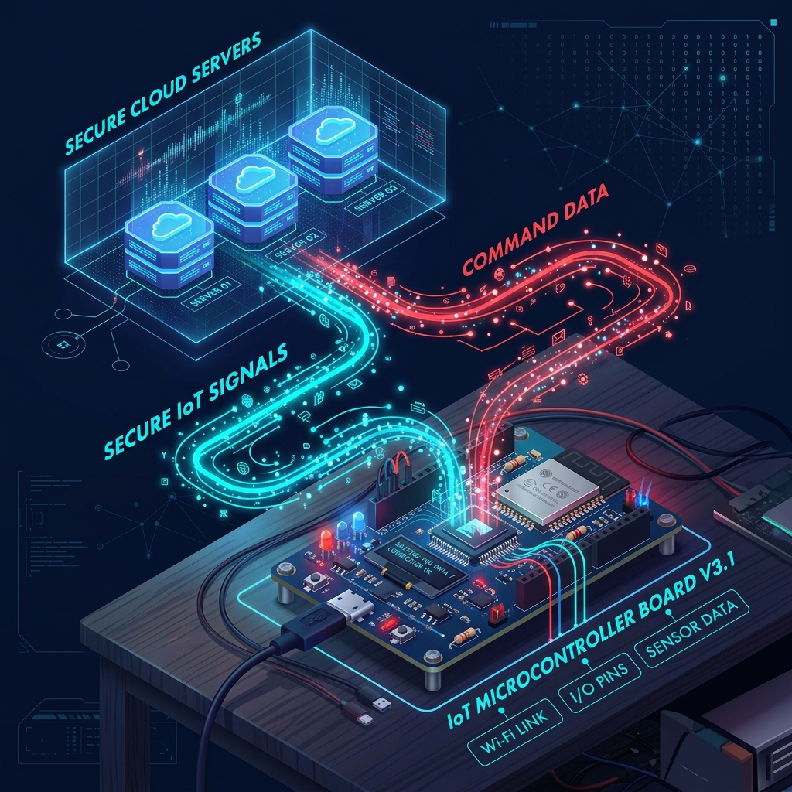
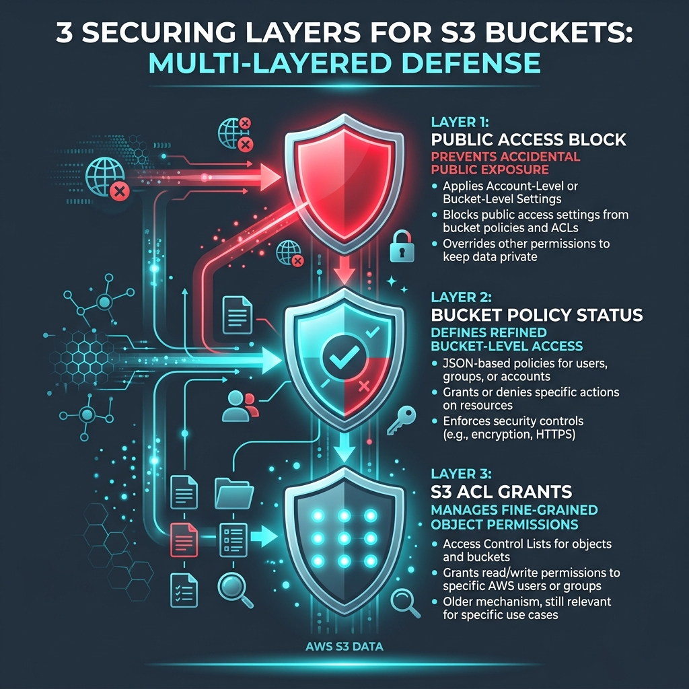
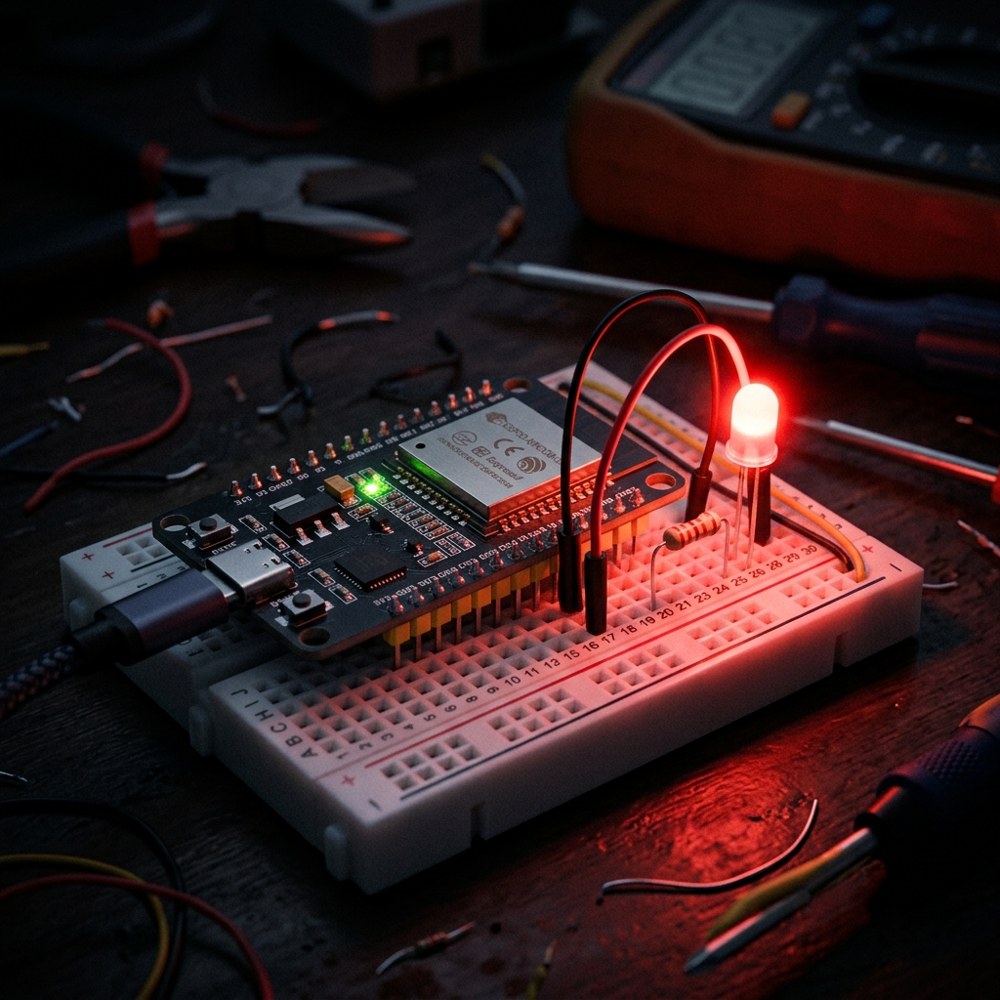
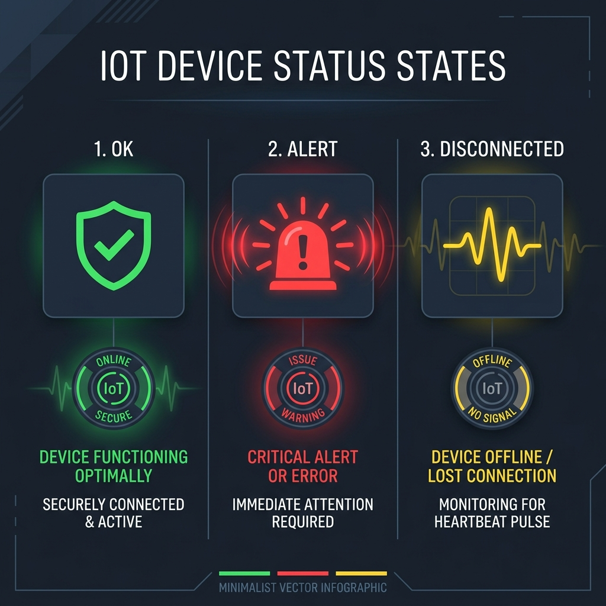
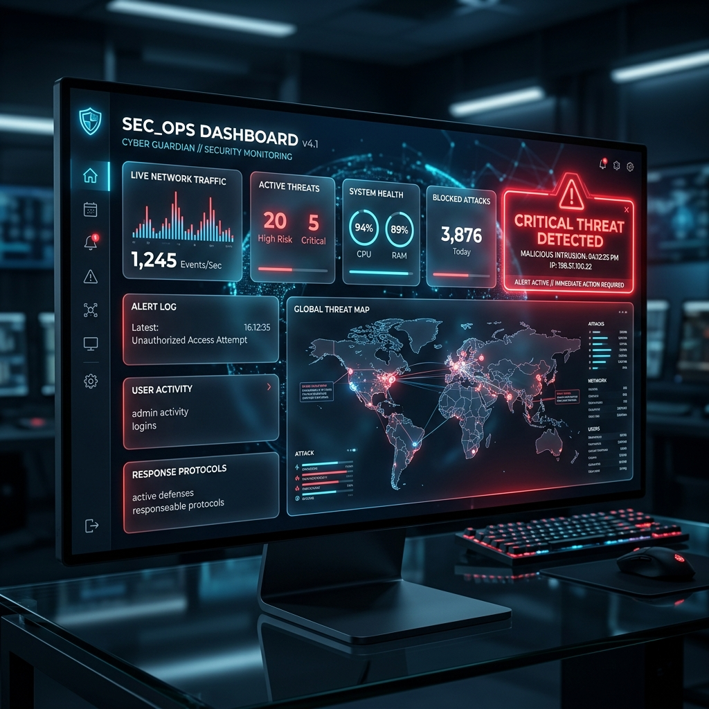

# 🚨💡 Cloud Security Alert Lamp: Ultra-Visual Class Presentation Deck & Script

> **Topic:** Real-Time IoT Physical Alert System for AWS S3 Bucket Public Exposure  
> **Target Audience:** Cybersecurity & Cloud Engineering Class  
> **Generated Visual Presentation Formats:**
> - 📄 **Visual PowerPoint Deck:** [Cloud_Security_Alert_Lamp_Presentation.pptx](file:///c:/cloud%20project/docs/Cloud_Security_Alert_Lamp_Presentation.pptx)
> - 🌐 **Interactive Web Deck:** [presentation.html](file:///c:/cloud%20project/docs/presentation.html)
> - 📜 **Generator Script:** [generate_ppt.py](file:///c:/cloud%20project/generate_ppt.py)

---

## 🎨 Visual AI Asset Showcase & Slide Script

---

### 🎴 Slide 1: Title & Hero Introduction
* **Header Tag:** `AWS CLOUD SECURITY & IoT HARDWARE`
* **Title:** Cloud Security Alert Lamp 🚨💡
* **AI Visual Asset:** 3D Cinematic Render of Security Desk with Glowing Red IoT Lamp
* **Subtitle:** Real-time IoT Physical Alert System for AWS S3 Bucket Exposure

> 🗣️ **Speaker Script (Say this in class):**  
> *"Good morning/afternoon everyone! Today I am presenting our project: the Cloud Security Alert Lamp. This project bridges cloud security auditing in AWS with physical IoT hardware. Whenever a public S3 bucket or misconfigured bucket policy occurs in our AWS environment, a physical Red LED on an ESP32 microcontroller blinks rapidly on the engineer's desk to provide sub-second physical awareness."*

---

### 🎴 Slide 2: The Problem - S3 Misconfigurations & Email Fatigue

* **Header Tag:** `PROBLEM STATEMENT`
* **Title:** The Danger of S3 Misconfigurations & Email Fatigue
* **AI Visual Asset:** 3D Cloud Data Leakage Concept vs Quiet Workstation Alert

> 🗣️ **Speaker Script:**  
> *"Why did we build this? Misconfigured S3 buckets remain one of the top causes of major cloud breaches. Security teams receive hundreds of alert emails daily, leading to severe alert fatigue. By introducing a physical ambient warning light in the workplace, we bring critical threat awareness into the real world, eliminating response delays."*

---

### 🎴 Slide 3: End-to-End System Solution Architecture

* **Header Tag:** `SYSTEM ARCHITECTURE`
* **Title:** End-to-End Cyber-Physical Data Pipeline
* **AI Visual Asset:** 3D Isometric Architectural Diagram linking AWS Cloud, IoT Core, ESP32, and Web Twin.

> 🗣️ **Speaker Script:**  
> *"Here is the high-level architecture diagram of our solution. It consists of four main building blocks: the AWS Lambda Auditor, AWS IoT Core MQTT message broker, the physical ESP32 Hardware Lamp, and the Web Dashboard Twin. Data flows seamlessly from cloud inspection to physical hardware state in milliseconds."*

---

### 🎴 Slide 4: Deep Dive - AWS Lambda 3-Layer Auditor

* **Header Tag:** `AWS CLOUD SCANNER`
* **Title:** Deep Dive: AWS Lambda 3-Layer Security Audit
* **Visual Asset:** 3-Layer Security Shield Diagram (Public Access Block, Bucket Policy Status, & S3 ACL Grants).

---

### 🎴 Slide 5: Deep Dive - AWS IoT Core & Mutual TLS Security

* **Header Tag:** `SECURITY & PROTOCOLS`
* **Title:** AWS IoT Core Mutual TLS & X.509 Security
* **AI Visual Asset:** 3D Glowing Digital Shield Vault representing X.509 Encryption Keys & TLS 1.2 Data Tunnel.

---

### 🎴 Slide 6: ESP32 Hardware Schematics & Wiring

* **Header Tag:** `HARDWARE DESIGN`
* **Title:** ESP32 Circuit Schematics & Pinout Wiring
* **AI Visual Asset:** Macro Photo Render of ESP32 Dev Board on Breadboard with Glowing Red LED Actuator.

---

### 🎴 Slide 7: ESP32 Firmware State Machine

* **Header Tag:** `FIRMWARE ARCHITECTURE`
* **Title:** ESP32 C++ Non-Blocking Finite State Machine
* **Visual Diagram:** 3-State Machine Infographic (`STATE_OK`, `STATE_ALERT`, `STATE_DISCONNECTED`).

---

### 🎴 Slide 8: Interactive Web Twin Dashboard

* **Header Tag:** `DIGITAL TWIN`
* **Title:** Interactive Web Twin Dashboard & Simulator
* **AI Visual Asset:** Glassmorphism Computer UI Screen Render showing Real-time Security Metrics & Neon Alert Light.

---

### 🎴 Slide 9: Automated Provisioning & Test CLI
* **Header Tag:** `AUTOMATION`
* **Title:** Automated Provisioning & Test CLI Utilities

---

### 🎴 Slide 10: Step-by-Step Live Classroom Demonstration
* **Header Tag:** `CLASSROOM DEMO`
* **Title:** Step-by-Step Live Demonstration Guide

---

### 🎴 Slide 11: Security Engineering Key Takeaways
* **Header Tag:** `TAKEAWAYS`
* **Title:** Key Security Engineering Lessons

---

### 🎴 Slide 12: Q&A & Conclusion
* **Title:** THANK YOU! 🚨💡
* **Subtitle:** Questions & Technical Discussion

---

## 🖥️ How to Present in Class

1. **PowerPoint Deck (`.pptx`):** Open [Cloud_Security_Alert_Lamp_Presentation.pptx](file:///c:/cloud%20project/docs/Cloud_Security_Alert_Lamp_Presentation.pptx) in PowerPoint.
2. **Interactive Browser Deck (`.html`):** Open [presentation.html](file:///c:/cloud%20project/docs/presentation.html) in Chrome/Edge. Press **N** to view speaker script drawer.
